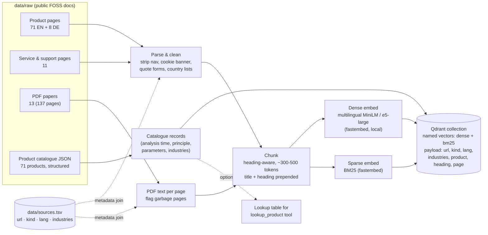
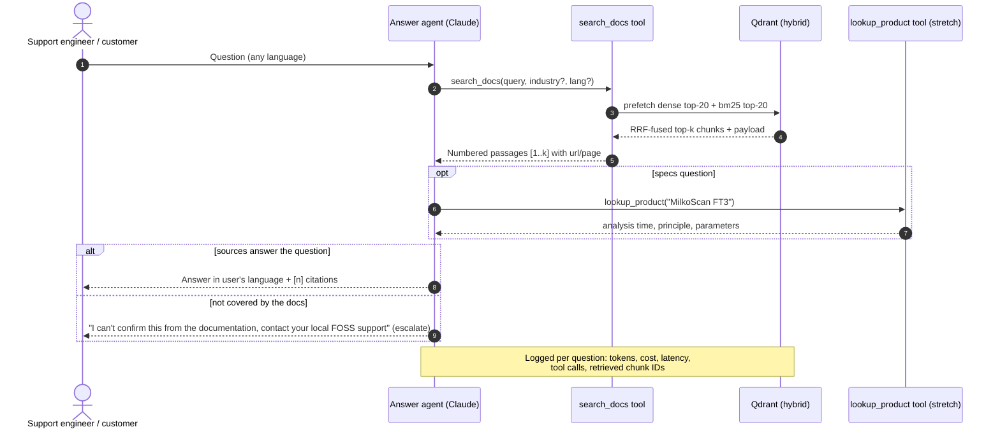
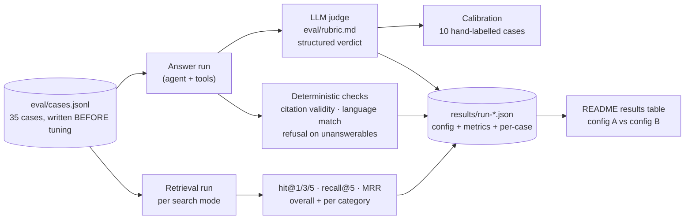
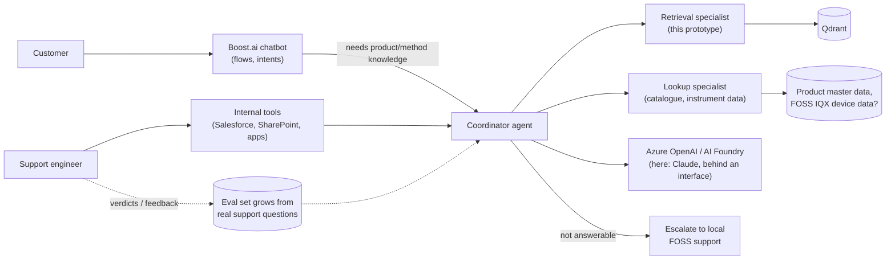

# Architecture

Four views: **offline ingestion**, **online query**, **evaluation loop**, and **how it would sit at FOSS**.
The diagrams are Mermaid: they render on GitHub, and in VS Code with a Mermaid preview extension. A plain-text summary is at the bottom.

## 1. Offline: ingestion and indexing


## 2. Online: answering a question


## 3. Evaluation loop


## 4. How this maps to FOSS (hypothesis, based on the posting)
The posting says FOSS has a **Boost.ai customer chatbot**, "**AI agents that handle specialist retrieval and lookups**", models on **Azure OpenAI / AI Foundry**, **Qdrant**, and integrations with SharePoint, Salesforce and the company apps. This prototype is the "specialist retrieval" piece.


**Talking point:** "In my prototype the model client and the embedding model sit behind one interface, so moving to Azure OpenAI is a configuration change, and Qdrant is the same as yours. The part I can't build without you is the evaluation set: it should come from your support engineers' real questions."

---

## Plain-text summary
```
OFFLINE  data/raw ─► parse+clean ─► chunk(+title/heading) ─► dense(e5/MiniLM) + sparse(BM25) ─► Qdrant(payload: url,kind,lang,industries,page)
ONLINE   question ─► Claude ─tool─► search_docs ─► Qdrant hybrid (prefetch dense+bm25 → RRF) ─► top-k ─► answer with [n] citations | escalate
EVAL     cases.jsonl ─► retrieval metrics + answers ─► deterministic checks + LLM judge(rubric) ─► results/*.json ─► README table
```

## Component choices (see `decisions.md` for the why)
| Component | Choice | Swap-able to |
|---|---|---|
| Vector DB | Qdrant 1.20 (Docker or embedded) | (FOSS uses Qdrant) |
| Dense embeddings | fastembed: `paraphrase-multilingual-MiniLM-L12-v2` → `multilingual-e5-large` | Azure OpenAI embeddings |
| Sparse | fastembed `Qdrant/bm25` (IDF in Qdrant) | SPLADE / miniCOIL |
| Fusion | Qdrant Query API, RRF | DBSF, weighted |
| LLM | Claude Opus 5.5 via the `anthropic` SDK, manual tool loop | Azure OpenAI / Foundry model |
| Judge | Claude, structured output, rubric | Human labels from support engineers |
